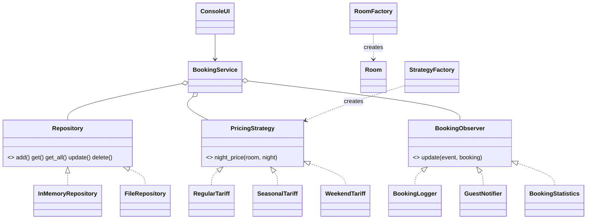

# Лабораторная работа №8. Вариант 5. Гостиница

Система бронирования номеров. Паттерны: **Repository**, **Factory**, **Strategy**
и дополнительный **Observer**.

| Папка | Содержимое |
|-------|------------|
| `naive/hotel_naive.py` | этап 1 — наивная реализация на `if/elif` |
| `patterns/` | этап 3 — реализация с паттернами |

## Запуск

```bash
cd naive && python hotel_naive.py
cd patterns && python main.py
cd patterns && python -m unittest discover -s tests -t . -v
```

## Анализ (этап 2)

| Паттерн | Проблема наивной версии | Решение | Классы | Плюсы / минусы |
|---------|-------------------------|---------|--------|----------------|
| Factory | номера создаются в `create_room` цепочкой `if/elif`, характеристики разбросаны по коду | `RoomFactory.create(type, id)` | `RoomFactory`, `Room`, `RoomType` | создание отделено от использования, новый тип регистрируется через `register`; минус — ещё один класс |
| Strategy | тариф выбирается `if tariff == ...` внутри расчёта стоимости | `PricingStrategy.night_price(room, night)` | `RegularTariff`, `SeasonalTariff`, `WeekendTariff`, `BookingService.set_strategy` | тарифы меняются во время работы, новый тариф — новый класс; минус — больше файлов |
| Repository | словари номеров и броней хранятся внутри сервиса | интерфейс `Repository` | `InMemoryRepository`, `FileRepository` | сервис не знает, где лежат данные; можно выбрать хранилище при запуске |
| Observer | журнал, уведомление гостя и выручка жёстко вызываются из `book()` | `BookingService.subscribe(observer)` | `BookingLogger`, `GuestNotifier`, `BookingStatistics` | слабая связанность, подписчиков можно добавлять без изменения сервиса; минус — порядок вызовов неявный |
| Factory + Strategy | — | `StrategyFactory.create("seasonal")` | `StrategyFactory` | UI выбирает тариф по названию, не зная конкретных классов |

## Сравнение решений

| Характеристика | До | После |
|----------------|----|-------|
| Создание объектов | `if/elif` | Factory |
| Выбор алгоритма | `if/elif` | Strategy |
| Хранение данных | внутри сервиса | Repository (память / файл) |
| Уведомления | жёсткие вызовы | Observer |

## Диаграмма классов



## Тесты

8 тестов: Factory (2), Strategy, Repository (2), бизнес-операции (2), Observer.
